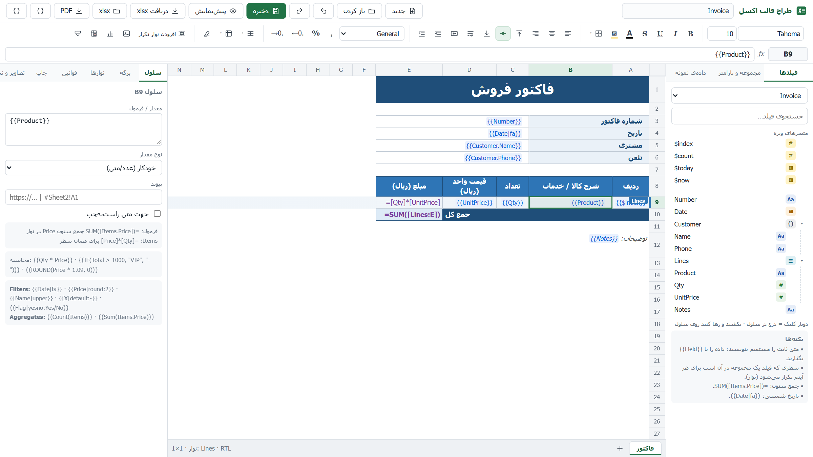

# KSC.Excel

**Design a report once in a visual designer — your code only supplies data. Get a beautiful `.xlsx` from the template (and PDF with the companion [KSC.Excel.Pdf](https://github.com/Mohsenbahrzadeh/KSC.Excel.Pdf) repository).**
A Stimulsoft-style report designer + engine for **.NET 8/10 and .NET Framework 4.x**, with first-class **Persian / Arabic / RTL** support.
No EPPlus / ClosedXML / OpenXML SDK in your code, no Excel on the server, no CDN (works on an intranet).

**طراح تصویری گزارش (شبیه Stimulsoft)؛ برنامه‌نویس فقط داده می‌دهد و از همان قالب هم `xlsx` و هم `PDF` می‌گیرد.** برای .NET 8/10 و .NET Framework؛ فارسی و راست‌به‌چپ کامل.



```csharp
return this.ExcelFile("Invoice", model, "invoice.xlsx");     // ASP.NET Core: Excel download
return this.Excel("Invoice", model, "invoice.xlsx");         // MVC 5 (.NET Framework)
```

```cshtml
@await Component.InvokeAsync("KscExcelViewer", new { template = "Invoice", data = Model })   @* report in the page + download *@
@Html.KscExcelViewer("Invoice", Model, "invoice")                                            @* same on MVC 5 *@
```

> PDF: the engine exposes a hook (`KscExcelOptions.PdfExporter`); the **KSC.Excel.Pdf** repository/package plugs the PDF renderer, the `PdfFile` / `Pdf` results and the in-page PDF viewer into it with `o.UsePdf()`.

## What you can build

| | |
|---|---|
| **Designer** | Excel-like grid, drag & drop fields, live preview, undo/redo, multi-sheet, RTL; embedded in your web app (ASP.NET Core / MVC 5) **or** a Windows desktop app (.NET 10 / .NET Framework 4.8) |
| **Layout** | repeating **bands** (master/detail/detail), **sort & group with group totals**, **cross-tab** (dynamic columns), report header / page header / footer, **page break per group**, sheet repeat, charts, images, merged cells |
| **Data** | objects, dictionaries, JSON, `DataTable`, read-only parameterised **SQL**, **REST/JSON endpoints**, **your own code providers** (EF / Dapper / any service), inline JSON, report **parameters** |
| **Expressions** | `{{Qty * Price}}`, `IF(...)`, filters (`{{Date\|fa}}` Persian date), aggregates, live Excel formulas with tokens (`=SUM([Lines.Qty])`), custom functions & filters |
| **Visuals** | conditional formatting (7 kinds), data bars, colour scales, rotated text, **barcodes & QR codes**, **watermark**, hyperlinks |
| **Outputs** | `.xlsx` (verified in real Excel; streaming writer: 1 M rows ≈ 12 s / 47 MB), HTML viewer; PDF through the companion KSC.Excel.Pdf |
| **Import** | turn an existing `.xlsx` into a template |

## Packages

| Package | Target | |
|---|---|---|
| `KSC.Excel` | netstandard2.0 | engine, importer, designer API + UI (only dependency: Newtonsoft.Json) |
| `KSC.Excel.AspNetCore` | net8.0, net10.0 | `AddKscExcel`, `MapKscExcelDesigner`, `ExcelFile`, `KscExcelViewer` |
| `KSC.Excel.Mvc` | net472, net48 | MVC 5: `KscExcel.Initialize`, designer route, `Excel`, `Html.KscExcelViewer` |
| `KSC.Excel.Designer.Windows` | net10.0-windows, net48 | desktop designer (release download, not a NuGet package) |

## Quick start

```bash
git clone https://github.com/Mohsenbahrzadeh/KSC.Excel.git
cd KSC.Excel
dotnet run --project samples/KSC.Excel.Sample.Web --urls http://localhost:5199 -- --environment Development
# open http://localhost:5199/excel-designer   (designer)
```

In your own ASP.NET Core app:

```csharp
builder.Services.AddKscExcel(o =>
{
    o.AddModel<Invoice>("Invoice");               // field tree + sample data for the designer
    o.AddProvider("Orders", p => db.Orders.ToList());                       // optional: any data source
    o.AddHttpEndpoint("Crm", "https://crm.example.com/api/", headers);      // optional: REST
});
app.MapKscExcelDesigner("/excel-designer").RequireAuthorization();   // keep the designer behind login
app.MapKscExcelDownloads();                                           // only for the viewers
```

.NET Framework (MVC 5): see `samples/KSC.Excel.Sample.Mvc5` (a ready site, verified on IIS Express):

```bash
dotnet build samples/KSC.Excel.Sample.Mvc5
"C:\Program Files\IIS Express\iisexpress.exe" /path:samples\KSC.Excel.Sample.Mvc5 /port:5290
```

## Documentation

| | English | فارسی |
|---|---|---|
| **Complete guide** | [Guide (md)](docs/guide/KSC.Excel-Guide.en.md) · [PDF](docs/guide/KSC.Excel-Guide.en.pdf) | [راهنما (md)](docs/guide/KSC.Excel-Guide.fa.md) · [PDF](docs/guide/KSC.Excel-Guide.fa.pdf) |
| Design & architecture | — | [KSC.Excel-Design.md](docs/KSC.Excel-Design.md) |

## Build & test

```bash
dotnet build
dotnet test tests/KSC.Excel.Tests          # net10.0 and net48 (Windows)
```

Barcodes are checked against an independent decoder (ZXing).

## Status & limitations

Production-oriented but young. Honest list:
- **No separate sub-report templates**: the grid engine covers master/detail with nested bands and several data sets instead.
- Elements are cells in a grid (like Excel); there are no free-floating report objects.
- HTML preview does not draw images/barcodes. Fonts are not embedded in `.xlsx`.
- Verified: desktop Excel, IIS Express with .NET Framework 4.8, Windows desktop designer on .NET 10 and .NET Framework 4.8. **Not tested:** LibreOffice, Excel Online, Google Sheets.

## Security

The designer can write templates: **protect it** (`RequireAuthorization`) and consider `ReadOnlyDesigner` in production. SQL data sets are **off by default** (`AllowSql`); REST endpoints and providers exist only if you register them in code. See [SECURITY.md](SECURITY.md) to report vulnerabilities privately.

## Contributing & license

See [CONTRIBUTING.md](CONTRIBUTING.md). Licensed under the [MIT License](LICENSE).
